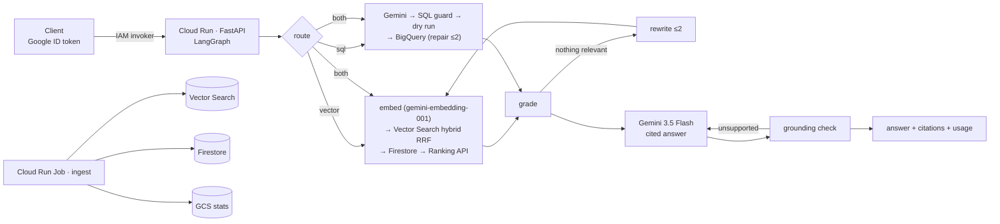
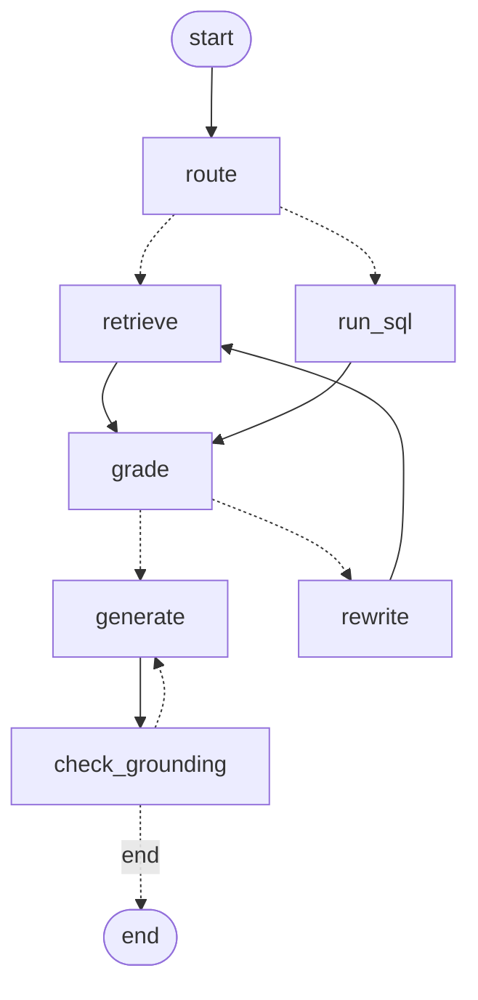

# Enterprise RAG Assistant on Google Cloud

**Python · LangGraph · Gemini · Vertex AI Vector Search · BigQuery · Cloud Run**

An internal-knowledge assistant for a fictional company, *Helios Robotics*. It answers questions from policy
documents **and** from analytics tables, cites every claim, says "I don't know" when the sources don't
cover a question, and reports its own latency, token throughput and cost per request.

- Documents are chunked by structure, embedded (dense + BM25 sparse) and served from **Vertex AI Vector
  Search** with hybrid RRF retrieval and **Vertex AI Ranking API** reranking.
- Numbers come from **BigQuery** through a guarded **text-to-SQL** tool: AST guard, dry run, byte cap and a
  repair loop.
- A **LangGraph** state graph routes each question (vector / SQL / both in parallel), grades relevance,
  rewrites and retries when retrieval misses, generates a cited answer with **Gemini 3.5 Flash**, and
  checks grounding before responding.
- **FastAPI on Cloud Run**, IAM-only (no public access), keyless CI/CD over **Workload Identity Federation**,
  and an **evaluation harness** gating recall@k, faithfulness, p95 latency, tokens/s and cost per request.

---

## Architecture



LangGraph, exported from the compiled graph (`uv run rag export-graph`):



More detail: [docs/architecture.md](docs/architecture.md).

## How each claim maps to the code

| Claim | Where it lives | How it's verified |
| --- | --- | --- |
| Python ingestion pipeline chunks + embeds unstructured documents into **Vertex AI Vector Search** | `src/rag/ingestion/` (md/txt/html/pdf loaders, heading-aware 350/60-token chunker, idempotent manifest sync, `--prune`), `src/rag/store/vertex.py` (batched `upsert_datapoints` with sparse embeddings) | `tests/test_chunker_loaders.py`, `tests/test_ingestion.py` (idempotency, stale-chunk deletion, prune), stubbed Vertex tests |
| Structured data in **BigQuery** queried via a **text-to-SQL tool** | `src/rag/sql/` (catalog from BigQuery column descriptions, sqlglot guard, dry run + `maximum_bytes_billed`, repair loop) | 22 attack cases in `tests/test_sql.py`, repair loop on DuckDB |
| **LangGraph** state graph with routing between vector and SQL paths | `src/rag/graph/` (`route` → conditional fan-out, parallel `both` superstep) | `tests/test_graph.py` covers every path, including a parallelism timing test |
| **Hybrid retrieval (dense + sparse) with reranking** | `src/rag/retrieval/` (BM25 via feature hashing, query-side IDF, RRF α=0.6), `providers/vertex_ranker.py` (Ranking API with lexical fallback) | `tests/test_retrieval.py` (dot product == BM25, RRF α semantics) |
| **Self-correcting relevance-grading step** | `grade` → `rewrite` (≤2) → `retrieve`, then abstain | rewrite/abstain/recovery tests |
| **Gemini** generating **grounded answers with citations** | `generate` (`[S#]`/`[SQL1]` labels, untrusted-source prompt, citation validation) + `check_grounding` with one regeneration | citation validation + regeneration tests |
| **FastAPI on Cloud Run, IAM auth** | `src/rag/api/` (ID-token verification, allowlist, request-ID/trace middleware, JSON logs), `infra/terraform/cloudrun.tf` (no `allUsers`) | `tests/test_api.py` (401/403 cases, wrong audience, allowlist, 503 hygiene) |
| **CI/CD with GitHub Actions** | `.github/workflows/ci.yml` (lint, mypy, tests ≥80% coverage, offline eval gate, Docker, Terraform), `cd.yml` (WIF deploy, smoke, live eval) | see BLOCKERS.md for the workflow-scope status |
| **Evaluation harness**: recall@k, faithfulness, p95 latency, tokens/sec, cost per request on a **golden question set** | `src/rag/eval/`, `eval/golden_set.jsonl` (35 items), `eval/thresholds.yaml` | `tests/test_telemetry_eval.py`; reports in `eval/reports/` |

## Results

All numbers below are copied from committed reports. None are estimated.

**Offline (CI regression gate)**, from [`eval/reports/20261117T183540Z-local.md`](eval/reports/20261117T183540Z-local.md).
Heuristic reasoner, hash embeddings, in-memory hybrid index, DuckDB; 35 golden questions:

| recall@5 | MRR | route accuracy | answer correctness | faithfulness (lexical proxy) | abstention accuracy | p95 latency |
| --- | --- | --- | --- | --- | --- | --- |
| 1.00 | 1.00 | 1.00 | 0.875 | 1.00 | 1.00 | 27.4 ms |

These validate the plumbing. They are not a model-quality claim: the offline heuristics were tuned on this
golden set, and the corpus has only 8 documents. See [docs/evaluation.md](docs/evaluation.md).

**Live (Cloud Run + Gemini + Vector Search + BigQuery):** *pending deployment.* GCP authentication is
outstanding; see [BLOCKERS.md](BLOCKERS.md). This table will be filled verbatim from the committed live
report: recall@5, faithfulness (Gemini judge), p95 latency, output tokens/s, cost per request.

Engineering quality: 117 offline tests, 89% line coverage, mypy (disallow-untyped-defs) clean, ruff clean.

## Quickstart (offline, no cloud account needed)

```bash
uv sync --frozen
uv run rag ingest                     # chunk + embed the 8 sample docs into a local hybrid index
uv run rag query "What is the standard warranty period for the Atlas AMR, and how many SEV1 support tickets were opened for the Atlas AMR in 2025?"
```

Offline mode uses the deterministic heuristic reasoner (extractive answers, pattern SQL over DuckDB), so the full graph
runs with no credentials. `RAG_PROFILE=prod` switches every component to Gemini / Vertex AI / BigQuery.

Run the API locally (`RAG_AUTH_MODE=none` by default):

```bash
uv run rag serve --port 8080
curl -s localhost:8080/v1/query -H 'Content-Type: application/json' \
  -d '{"question": "What is the minimum password length?", "debug": true}'
```

Windows: `.\tasks.ps1 setup`, `.\tasks.ps1 test`, `.\tasks.ps1 eval`, `.\tasks.ps1 dev`.

## Deploy to Google Cloud

```powershell
gcloud auth login; gcloud auth application-default login
.\scripts\bootstrap_project.ps1       # project + billing + APIs
.\scripts\deploy.ps1                  # terraform → Cloud Build → Cloud Run → seed BigQuery → ingest → smoke
.\tasks.ps1 eval-live                 # live evaluation report
```

Bash: `./scripts/deploy.sh all`. Step-by-step instructions and operations are in [docs/runbook.md](docs/runbook.md).

Calling the deployed service:

```bash
curl -s -X POST "$SERVICE_URL/v1/query" \
  -H "Authorization: Bearer $(gcloud auth print-identity-token)" \
  -H "Content-Type: application/json" \
  -d '{"question": "Which region had the highest revenue in 2024?"}'
```

## Security model
- **No public access.** Cloud Run has no `allUsers` binding, and unauthenticated calls get 403 at Google's
  front end. The app re-verifies the Google ID token (audience, issuer, expiry) and enforces an email
  allowlist ([ADR 0004](docs/adr/0004-iam-and-wif-auth.md)).
- **No keys.** GitHub Actions uses OIDC through Workload Identity Federation, restricted to this repository.
  No service-account JSON keys exist.
- **Least privilege.** The runtime SA can only read: BigQuery `dataViewer` on one dataset plus `jobUser`,
  Firestore user, bucket objectViewer, Vertex AI user.
- **SQL defence in depth.** IAM read-only → AST guard → dry-run byte cap → `maximum_bytes_billed` → labels
  and timeout ([ADR 0003](docs/adr/0003-text-to-sql-guardrails.md)).
- **Prompt injection.** Sources are framed as untrusted data, citations are validated against the sources
  actually provided, and a grounding judge checks the answer before it is returned.

## Cost
Cloud Run scales to zero; Firestore, BigQuery and GCS stay within free tiers at demo scale. The
**Vector Search deployed index is the main cost: about $2.3/day (~$68/month) for one e2-standard-2 node**
(list-price estimate; see [docs/cost.md](docs/cost.md)). Stop it when idle and keep the index data:

```powershell
.\tasks.ps1 vs-undeploy     # make vs-undeploy
```

The measured cost per request will be published from the live eval report.

## Repository map
```
src/rag/            config, telemetry (usage/cost), observability (JSON logs), container (DI), cli
  ingestion/        loaders (md/txt/html/pdf), structure-aware chunker, idempotent pipeline
  retrieval/        BM25 sparse encoder (query-side IDF), hybrid retriever
  store/            in-memory hybrid index (RRF), Vertex Vector Search, docstores (JSON/Firestore)
  sql/              catalog, guard, DuckDB + BigQuery engines, text-to-SQL repair loop
  graph/            state, prompts, reasoners (Gemini + heuristic), nodes, builder, service
  api/              FastAPI app, IAM auth, middleware, schemas
  eval/             metrics, judges, runner
data/               synthetic documents (8) + structured CSVs + schema.yaml
eval/               golden_set.jsonl, thresholds.yaml, reports/
infra/terraform/    APIs, GCS, AR, Firestore, BigQuery, Vector Search, IAM, WIF, Cloud Run, metrics, budget
scripts/            deploy / smoke / vs_undeploy / teardown (.sh + .ps1), data generator, secret scan
docs/               architecture, ADRs, decisions, runbook, cost, evaluation, api
```

## Roadmap
- Streaming responses (SSE) with incremental citations.
- Per-user document ACLs through Vector Search restricts (namespace filters) mapped from Google Groups.
- Semantic cache for repeated questions; prompt caching for the system prompt.
- Larger golden set with adversarial / prompt-injection items, and per-category live thresholds.
- Terraform-managed alerting policies on the log-based latency and cost metrics.

## License
MIT. The company, people and data are fictional and synthetic.
