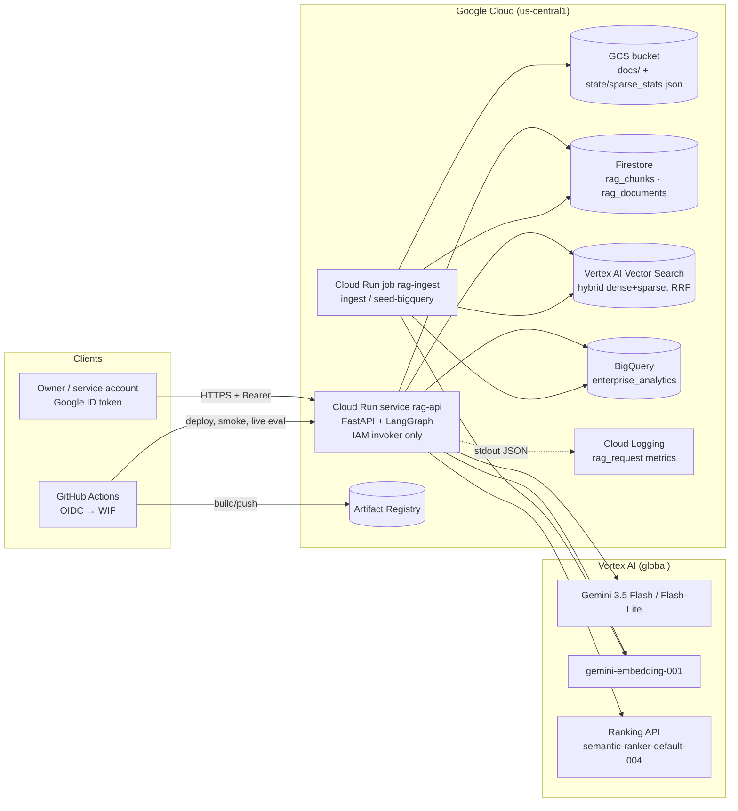
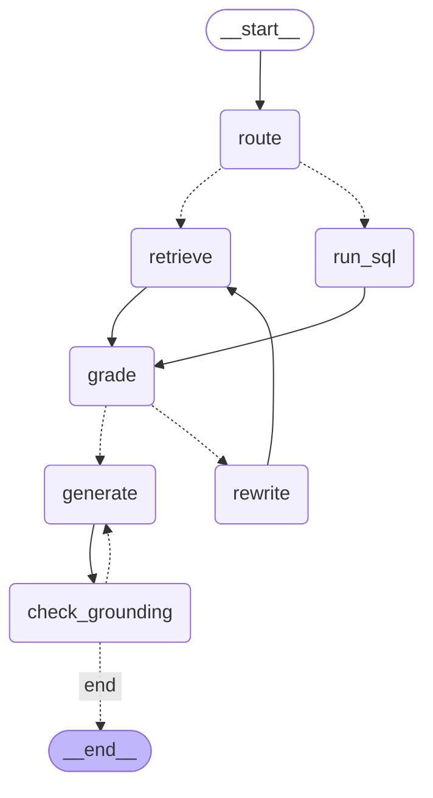
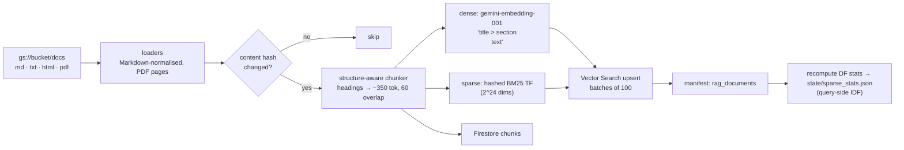

# Architecture

## System

## Request flow (LangGraph)

Exported from the compiled graph (`uv run rag export-graph`):

| Node | Model / service | Output |
| --- | --- | --- |
| `route` | Flash-Lite, structured JSON | `{route: vector\|sql\|both, reason}` |
| `retrieve` | gemini-embedding-001 → Vector Search hybrid (k=30, α=0.6) → Firestore → Ranking API (top 6) | candidates + reranked passages, per-stage timings |
| `run_sql` | Flash-Lite drafts `{sql, explanation}` → guard → dry run → BigQuery, repair ≤ 2 | `SqlResult` |
| `grade` | Flash-Lite, one batched call | relevant passages |
| `rewrite` | Flash-Lite | new retrieval query (≤ 2 loops) |
| `generate` | Flash (thinking LOW) | cited answer or abstention |
| `check_grounding` | Flash-Lite judge | `{grounded, unsupported_claims}`; one regeneration |

## Ingestion

Removed documents are deleted with `--prune`. Changed documents delete their stale chunk IDs from both stores
first.

## Data model
* `Chunk {chunk_id = sha256(uri)[:16]-NNNN, doc_id, source_uri, title, section ("A > B"), text, page, index}`
* `DocumentRecord {doc_id, source_uri, title, content_hash, chunk_ids[], ingested_at}`
* BigQuery `enterprise_analytics.{sales_orders, support_tickets, headcount}`, with descriptions taken from
  `data/structured/schema.yaml`.

## Observability
* One structured `rag_request` log line per query: latency, route, tokens, cost, grounded, rewrites, sql_ok.
* `logging.googleapis.com/trace` correlation from `X-Cloud-Trace-Context`, and an `X-Request-ID` echo.
* Log-based metrics `rag_request_latency_ms` (by route) and `rag_request_cost_usd`.
